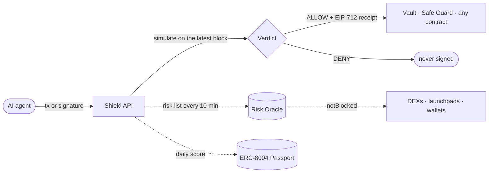

<picture>
  <source media="(prefers-color-scheme: dark)" srcset=".github/assets/hero-dark.svg">
  
</picture>

<p></p>

<p>
  <a href="https://heimdall.fund"><b>Website</b></a> ·
  <a href="https://heimdall.fund/docs"><b>Docs</b></a> ·
  <a href="https://heimdall.fund/token-check"><b>Token Check</b></a> ·
  <a href="https://api.heimdall.fund/openapi.json"><b>Shield API</b></a> ·
  <a href="https://x.com/HeimdallFund"><b>X</b></a>
</p>

<p>
  <a href="https://www.npmjs.com/package/@heimdallfund/sdk"></a>
  <a href="https://www.npmjs.com/package/@heimdallfund/mcp"></a>
  <a href="https://www.npmjs.com/package/@heimdallfund/agent-kit"></a>
  <a href="https://www.npmjs.com/package/@heimdallfund/plugin-heimdall"></a>
  <a href="https://pypi.org/project/heimdallfund/"></a>
  <a href="https://registry.modelcontextprotocol.io/v0/servers?search=fund.heimdall"></a>
</p>

Heimdall sits between an AI agent and its wallet. Before the agent signs, Shield simulates the transaction or signature on the latest block and answers **ALLOW**, **WARN** or **DENY**. An ALLOW comes with a signed receipt that Heimdall vaults, the Safe module and any contract can verify onchain. Everything Shield learns is written to an onchain Risk Oracle that any app on Robinhood Chain can read for free.

## Pick your door

| You are | Use | One line to start |
| --- | --- | --- |
| **Running an AI agent** | Shield, before every send and signature | `claude mcp add heimdall -- npx -y @heimdallfund/mcp` |
| **Building a DEX, launchpad or wallet** | Risk Oracle, one modifier | `contract App is HeimdallRiskAware { … notBlocked(to) … }` |
| **Giving an agent a Safe** | Guard for Safe, daily limits and receipts | Enable `HeimdallGuardModule` from the Safe |
| **Selling an API to agents** | x402 facilitator, USDG per call, no keys | `GET /x402/supported` |
| **Hiring another agent** | Agent Passport, a score on ERC-8004 | `await shield.passport(agentAddress)` |
| **Trading a token or memecoin** | Token Check: honeypot, tax, holders, dev wallet and launchpad curve, with an AI summary | [heimdall.fund/token-check](https://heimdall.fund/token-check) or `GET /v1/token/:address` |
| **Depositing** | Shield-guarded stock vaults (16 stock tokens), Pay escrow, Auto-Invest | [heimdall.fund/vaults](https://heimdall.fund/vaults) |

## Sixty seconds

<details open>
<summary><b>Check a transaction before the agent signs it</b></summary>

```ts
import { HeimdallShield, guardedSend } from "@heimdallfund/sdk";

const shield = new HeimdallShield({ apiKey: process.env.HEIMDALL_API_KEY });

// throws HeimdallDenied unless Shield says ALLOW
await guardedSend(wallet, { to, data, value }, { shield, policy: { strict: true } });
```
</details>

<details>
<summary><b>Keep drainers out of your contract</b></summary>

```solidity
import {HeimdallRiskAware, IHeimdallRisk} from "./HeimdallRiskAware.sol"; // MIT, copy it

contract MyLaunchpad is HeimdallRiskAware {
    constructor(IHeimdallRisk oracle) HeimdallRiskAware(oracle, false) {}

    function buy(address to) external notBlocked(msg.sender) notBlocked(to) {
        // blocked addresses never get here
    }
}
```
</details>

<details>
<summary><b>Pay per call with x402, no account</b></summary>

```ts
import { payX402 } from "@heimdallfund/sdk";

const paidFetch = payX402(fetch, wallet, { maxAmount: 10_000n }); // at most 0.01 USDG a call
const verdict = await paidFetch("https://api.heimdall.fund/v1/check", { method: "POST", body });
```
</details>

## How it fits together



## In this repo

```
contracts/          Solidity 0.8.28, Hardhat 3: vaults, Pay, Signals, Auto-Invest, Risk Oracle, Guard module, staking
  audit/            the pack for auditors: scope with file hashes, threat model, invariants, known issues
apps/shield/        Shield API (Hono): checks, receipts, x402 facilitator, Risk Oracle feed, passports
apps/monitor/       alerts, keeper and Risk Oracle sync, as a Vercel cron or a container
apps/web/           heimdall.fund (Next.js 16)
apps/mcp/           the hosted MCP server at mcp.heimdall.fund
apps/agent/         reference vault manager agent
apps/signals/       official pay-per-call signals
packages/sdk/       @heimdallfund/sdk
packages/mcp/       @heimdallfund/mcp, 16 tools for Claude, Cursor and any MCP client
packages/agent-kit/ tools for the Vercel AI SDK and LangChain
packages/plugin-heimdall/  ElizaOS plugin
packages/sdk-python/ heimdallfund on PyPI
docs/               the docs site (GitBook)
```

Run everything locally against a chain on your machine:

```bash
cd contracts && npx hardhat node                                  # terminal 1
cd contracts && npx hardhat run scripts/local-demo.ts --network localhost
cd apps/shield && npm start                                       # :8787
cd apps/web && cp .env.local-demo .env.local && npm run build && npm start
```

## Security

Six internal reviews found 4 serious and 10 medium issues, all fixed with a regression test each ([contracts/SECURITY_REVIEW_6.md](contracts/SECURITY_REVIEW_6.md) and the five before it). 162 contract tests run with 15 fuzz properties and 14 stateful invariants, and a launch rehearsal replays every product with real money on a mainnet fork. An independent audit comes next; its report will be published in full.

Found something? Email **security@heimdall.fund**. We reply within 48 hours.

## Live on Robinhood Chain

Deployed at block 122057226, verified on Sourcify and owned by a 2-of-3 Safe. Vaults open with a 10,000 USDG deposit cap.

| Contract | Address |
| --- | --- |
| Vault Factory | [`0x838fdede1ae6fbdc15f784030d78ca7543d1154d`](https://robinhoodchain.blockscout.com/address/0x838fdede1ae6fbdc15f784030d78ca7543d1154d) |
| Vault Deployer | [`0x59c2385ee4876405f535f6fcf8f7f566f48cb9fb`](https://robinhoodchain.blockscout.com/address/0x59c2385ee4876405f535f6fcf8f7f566f48cb9fb) |
| Signals | [`0x14bd445999dd254090ce86bfcf96df5d4a3e301d`](https://robinhoodchain.blockscout.com/address/0x14bd445999dd254090ce86bfcf96df5d4a3e301d) |
| Pay | [`0xd8bd0bfc6ad1c5cee42c4f64bfcea9555a170265`](https://robinhoodchain.blockscout.com/address/0xd8bd0bfc6ad1c5cee42c4f64bfcea9555a170265) |
| Auto-Invest | [`0xeacf613ff7d6dbc8acbf51b411ad092d48e5a932`](https://robinhoodchain.blockscout.com/address/0xeacf613ff7d6dbc8acbf51b411ad092d48e5a932) |
| Risk Oracle | [`0x84da850303db7cca6d5194b9d9f8f392a6c9e3e0`](https://robinhoodchain.blockscout.com/address/0x84da850303db7cca6d5194b9d9f8f392a6c9e3e0) |
| Guard Module (Safe) | [`0xd2a8815c10f1d71fc854edb7a78405db8fe86ae6`](https://robinhoodchain.blockscout.com/address/0xd2a8815c10f1d71fc854edb7a78405db8fe86ae6) |
| Admin Safe (2-of-3) | [`0xaF1c3b55D204899CEd14d23C996153bC82424168`](https://robinhoodchain.blockscout.com/address/0xaF1c3b55D204899CEd14d23C996153bC82424168) |

Every address, including the 16 stock price feeds, is in [contracts/deployments/robinhood.json](contracts/deployments/robinhood.json).

## License

[Business Source License 1.1](LICENSE). Read it, audit it, and build on Heimdall: the SDK, MCP server, agent kit and ElizaOS plugin are free to use with Heimdall's own contracts and services. Running a competing service from this code is not allowed until 2029-11-24, when it all becomes MIT. Contract interfaces and integration helpers (`IHeimdallRisk`, `IPriceFeed`, `HeimdallRiskAware`, `ShieldGuarded`) are MIT today.
