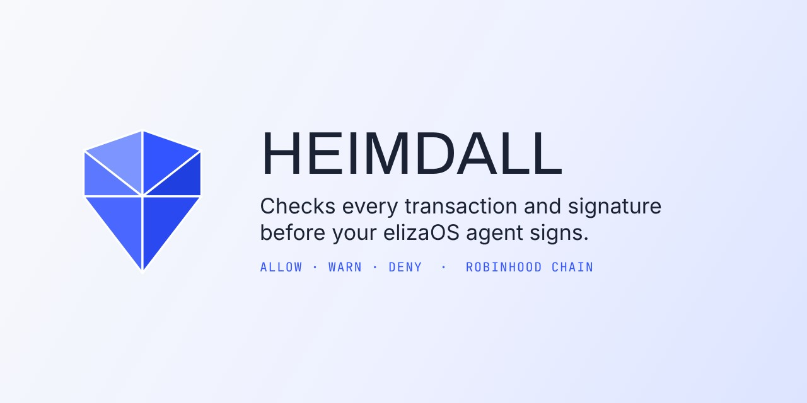

# @heimdallfund/plugin-heimdall

ElizaOS plugin for [Heimdall](https://heimdall.fund), the guardian layer for AI agents on Robinhood Chain.

Your agent checks every transaction and signature with Heimdall Shield before it signs: Shield simulates it, then answers ALLOW, WARN or DENY with the reasons and every token that would move. A DENY means do not sign.

```bash
npm i @heimdallfund/plugin-heimdall
```

```ts
import heimdall from "@heimdallfund/plugin-heimdall";

export const character = {
  name: "Trader",
  plugins: [heimdall],
  settings: { secrets: { HEIMDALL_API_KEY: process.env.HEIMDALL_API_KEY } },
};
```

## Actions

| Action | What it does |
| --- | --- |
| `HEIMDALL_CHECK_TRANSACTION` | Simulate a transaction: ALLOW, WARN or DENY, with reasons and token moves |
| `HEIMDALL_CHECK_SIGNATURE` | Judge EIP-712 and personal_sign requests: Permit, Permit2, Seaport, hidden approvals |
| `HEIMDALL_WALLET_CHECK` | Risky approvals a wallet has given, with the USD each spender could take |
| `HEIMDALL_AGENT_REPUTATION` | How another agent has behaved under Shield |
| `HEIMDALL_THREATS` | Known drainers, most-denied contracts and the community blocklist |
| `HEIMDALL_PAY_JOB`, `HEIMDALL_PAY_RECORD` | Heimdall Pay escrow jobs and provider track records (needs `HEIMDALL_PAY_ADDRESS`) |

To let the agent send only what Shield allows, build the plugin in code with a wallet: `heimdallPlugin({ wallet })` from `@heimdallfund/agent-kit/eliza` adds `HEIMDALL_SAFE_SEND`.

## Settings

| Setting | Meaning |
| --- | --- |
| `HEIMDALL_API_KEY` | Optional. Without a key you get the free tier |
| `HEIMDALL_API_URL` | Defaults to the public Shield API |
| `HEIMDALL_PAY_ADDRESS` | HeimdallPay contract, for the Pay actions |

Business Source License 1.1: free to use with Heimdall's own contracts and services (see LICENSE).
